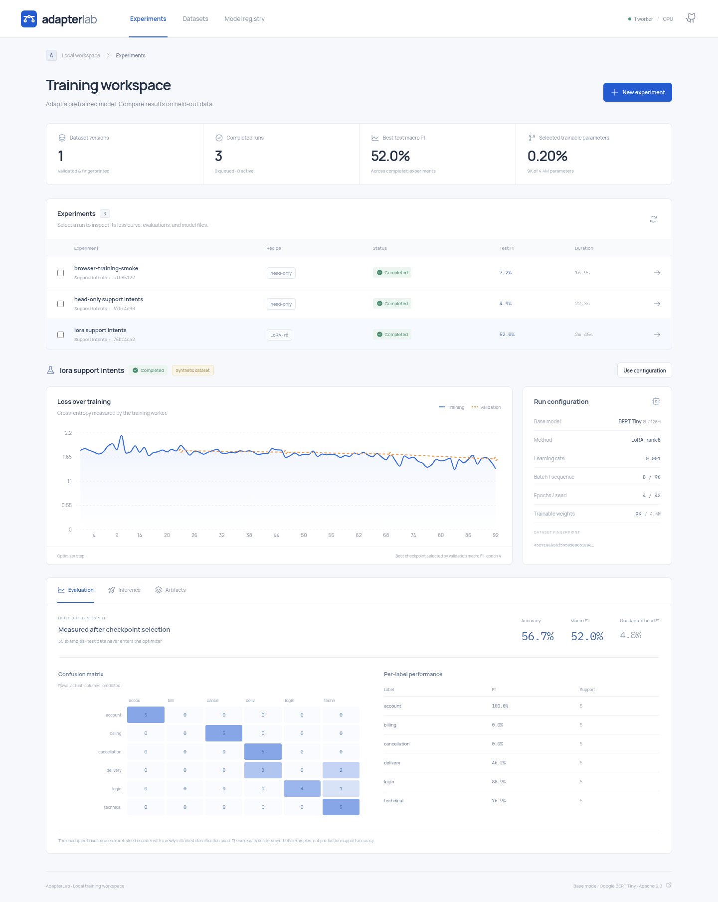

# AdapterLab

AdapterLab fine-tunes pretrained BERT text classifiers with LoRA, head-only training, or full fine-tuning. It validates dataset versions, queues CPU training jobs, compares held-out results, exports checkpoints, and serves predictions from the selected model.



## Run locally

Requirements: Python 3.12+, [uv](https://docs.astral.sh/uv/), and Node.js 24+.

```bash
uv sync --locked --extra ml --extra dev
npm --prefix frontend ci
npm --prefix frontend run build
uv run python scripts/dev.py
```

Open **http://127.0.0.1:8794**. The launcher starts the API and one worker. The API seeds a synthetic support-intent dataset, but no training runs or scores. Choose **New experiment** to train a model.

The first run downloads the pinned Google BERT Tiny checkpoint. Training and inference then execute on the local CPU. The default installation uses PyTorch's CPU wheel and two CPU threads per worker. No paid API, GPU, or Hugging Face credential is needed.

For a Vite development server, keep the API on port 8794 and run `npm --prefix frontend run dev` on port 5194. API documentation is at `/docs`.

## Training workflow

1. Import JSONL examples with `text`, `label`, and an optional `group` identifier, or use the bundled support-intent dataset.
2. Review class counts, possible personal-data flags, duplicate removal, and train/validation/test assignments.
3. Choose the recipe, LoRA rank, learning rate, epochs, batch size, sequence length, and seed.
4. Inspect loss and validation metrics while the worker runs. Cancellation takes effect between batches.
5. Compare completed runs on the same dataset fingerprint. Test scores appear only after checkpoint selection.
6. Download the model bundle or use the inference panel to inspect label scores.

| Recipe | Updated weights | Export |
|---|---|---|
| LoRA | Query/value adapters and classifier head | Adapter safetensors plus classifier weights and tokenizer |
| Head-only | Classifier head | Complete classifier checkpoint for portability |
| Full | Entire encoder and classifier | Complete classifier checkpoint |

LoRA targets BERT's query and value projections. The classifier is included in `modules_to_save`, so loading an adapter also restores its trained head. The loader rejects base checkpoints missing encoder or pooling weights.

## Base model

The base is [`google/bert_uncased_L-2_H-128_A-2`](https://huggingface.co/google/bert_uncased_L-2_H-128_A-2), pinned to revision:

```text
30b0a37ccaaa32f332884b96992754e246e48c5f
```

It has two encoder layers and a hidden size of 128. Checkpoints load from safetensors with remote code disabled. API clients cannot supply arbitrary model IDs or filesystem paths. The upstream weights use Apache 2.0; exported bundles include the base-model license.

## Dataset versions and splits

A dataset fingerprint covers normalized examples, labels, group IDs, and split assignments. Input order does not change the version. Exact normalized duplicates are removed; contradictory labels are rejected.

Groups must belong to one label. Each label needs at least five groups. Groups are ordered by a deterministic SHA-256 key, then assigned to train, validation, and test while retaining label coverage. Related template groups never cross splits. The bundled dataset has **240 examples: 180 train, 30 validation, and 30 test**.

The upload limit is 8 MB, with 30–10,000 examples and 2–20 labels. The personal-data check identifies possible email addresses and long digit sequences. It is a review aid, not a complete privacy scanner. Dataset bodies stay in the local database and are omitted from worker logs.

```json
{"text":"I cannot sign in after resetting my password.","label":"login","group":"login-password-reset"}
```

The [fixture catalog](data/fixtures/index.json) contains additional synthetic dataset versions for validating import, deduplication, and split behavior. These fixtures are not measured model results.

## CLI and Docker

Train one experiment without the UI:

```bash
uv run adapterlab-train --strategy lora --epochs 4
uv run adapterlab-train --strategy head-only --epochs 4
```

For separate processes:

```bash
uv run uvicorn adapterlab.api:app --host 127.0.0.1 --port 8794
uv run adapterlab-worker
```

Or run the packaged API and worker with persistent shared storage:

```bash
docker compose up --build --detach --wait
uv run python scripts/verify_training.py --url http://127.0.0.1:8010
```

The Compose port binds to loopback. Stop with `docker compose down`; add `--volumes` only when intentionally deleting the training database, model cache, and exported artifacts.

## Queue and recovery

Workers claim jobs with a conditional database update. A worker refreshes its lease during model loading and training. An expired lease marks a run failed without silently repeating its computation. Create a new run with the same configuration to retry. Optimizer-state resumption is not implemented.

Queued cancellation is immediate. Active cancellation is cooperative; the current download or batch may finish before cancellation is observed. A late worker cannot publish a successful result after losing its lease or receiving a cancellation request.

SQLite uses WAL and short transactions. The reference deployment runs one worker. Multiple workers can claim distinct jobs, but they share host CPU and memory; there is no GPU scheduler or cluster resource manager.

## Evaluation and exports

The worker records a before-adaptation baseline, training loss, and epoch-level validation metrics. The baseline has a pretrained encoder and an untrained classifier head; it is not a trained head-only comparison. Run the head-only recipe separately for that comparison.

Checkpoint selection uses validation macro F1, with validation loss breaking ties. The selected checkpoint is reloaded before final test evaluation. Accuracy, macro F1, per-label precision/recall/F1, and confusion matrices are computed from that test split.

Exports contain safetensors weights, tokenizer files, labels, the pinned base revision, configuration, dataset fingerprint, measured evaluation, training history, a model card, checksums, and the base-model license. Raw training examples are not included. Inference accepts one text input and does not persist it. Its softmax scores are uncalibrated.

The [example run](docs/example-run/evaluation.json) was actually executed on the synthetic dataset. Its small holdout does not establish performance on customer traffic. See [the measurement notes](docs/measurements.md).

## Access and storage

Local mode has no authentication and binds to loopback. For a shared installation, set `PROTECTED_MODE=true` and provide a random `OPERATOR_TOKEN` of at least 32 characters through the deployment environment. The dashboard keeps it only for the browser session. API clients use a bearer header.

Back up both `data/runtime` and `artifacts`; database records alone cannot restore exported weights. Put a shared installation behind TLS and restrict access to trusted operators. Dataset uploads can contain proprietary text, and this application is a single-tenant workbench.

After the pinned model has been cached, `HF_HUB_OFFLINE=1` prevents model-loading network lookups. Authentication tokens are explicitly disabled for the public base-model download.

## Verification

```bash
uv run ruff check backend tests scripts
uv run ruff format --check backend tests scripts
uv run pytest -q
uv run python scripts/verify_fixtures.py
npm --prefix frontend run format:check
npm --prefix frontend run build
npm --prefix frontend run test:browser
```

Unit tests use a small random-weight BERT fixture to exercise optimizer updates, all three recipes, safetensors export, exact reload behavior, queue ownership, cancellation, and access controls without a network dependency. The browser and container checks run actual training against the pinned pretrained model.

## Repository history

The project was created in October 2026. Its 2024–2025 author and committer dates are reconstructed for the owner's contribution-calendar exercise. Most historical increments add synthetic dataset-validation fixtures. They are not evidence of development or model training performed in those years. [Provenance](docs/provenance.json) records this separately from actual training timestamps.

MIT licensed. Base-model weights retain their upstream Apache 2.0 license.
